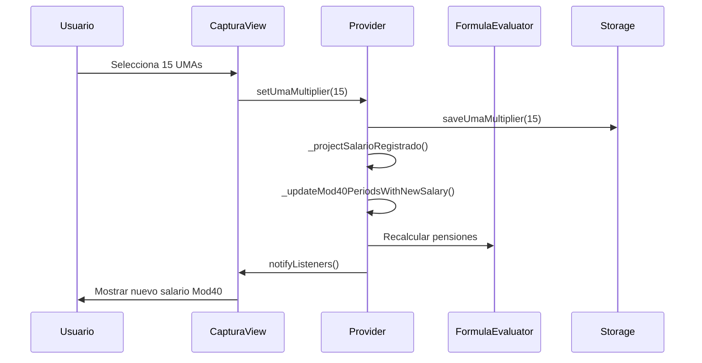

# Diagrama de Arquitectura: Multiplicador de UMA Configurable

```mermaid
graph TB
    subgraph "Estado Actual (Fijo en 25)"
        A1[PensionConstants.salarioRegistradoUmas = 25.0] --> B1[RetroactiveProvider]
        A2[app_metadata.json max_uma_multiplier = 25] --> C1[FormulaEvaluator]
        B1 --> D1[Salario Mod40 = 25 × UMA]
        C1 --> E1[Cap1 Ayuda Asistencial = 25 × UMA × 365]
    end

    subgraph "Nuevo Estado (Configurable 1-25)"
        F[UI Control Dropdown/Slider 1-25] --> G[RetroactiveProvider.setUmaMultiplier]
        G --> H[Persistencia saveUmaMultiplier]
        G --> I[_umaMultiplier variable]
        I --> J[Salario Mod40 = _umaMultiplier × UMA]
        I --> K[FormulaEvaluator usa _umaMultiplier]
        K --> L[Cap1 Ayuda Asistencial = _umaMultiplier × UMA × 365]
        H --> M[Recuperación en startup]
    end

    subgraph "Flujo de Cambios"
        N[Usuario cambia valor en UI] --> O[provider.setUmaMultiplier]
        O --> P[_projectSalarioRegistrado force:true]
        P --> Q[Recalcula salario Mod40]
        P --> R[Actualiza periodos Mod40]
        Q --> S[Recalcula pensiones]
        R --> T[Recalcula promedios]
        S --> U[UI se actualiza en tiempo real]
    end

    style A1 fill:#f9f,stroke:#333
    style F fill:#9f9,stroke:#333
```



## Componentes Clave a Modificar

### 1. RetroactiveProvider
```dart
class RetroactiveProvider {
  double _umaMultiplier = 25.0; // Nuevo campo
  
  double get umaMultiplier => _umaMultiplier;
  
  void setUmaMultiplier(double value) {
    if (value < 1 || value > 25) return;
    _umaMultiplier = value;
    persistence.saveUmaMultiplier(value);
    _projectSalarioRegistrado(force: true);
    notifyListeners();
  }
  
  void _projectSalarioRegistrado({bool force = false}) {
    // Cambiar de:
    // final nuevoSalario = PensionConstants.salarioRegistradoUmas * _umaDiaria;
    // A:
    final nuevoSalario = _umaMultiplier * _umaDiaria;
  }
}
```

### 2. PersistenceService
```dart
abstract class PersistenceService {
  Future<void> saveUmaMultiplier(double value);
  Future<double> loadUmaMultiplier(); // Retorna 25.0 si no existe
}
```

### 3. CapturaView UI
```dart
Widget _buildUmaMultiplierControl(RetroactiveProvider provider) {
  return Row(
    children: [
      Expanded(
        child: Text('UMAs a pagar en Mod40:'),
      ),
      Expanded(
        child: DropdownButton<double>(
          value: provider.umaMultiplier,
          items: List.generate(25, (i) => i + 1)
              .map((v) => DropdownMenuItem(
                    value: v.toDouble(),
                    child: Text('$v UMAs'),
                  ))
              .toList(),
          onChanged: (value) {
            if (value != null) provider.setUmaMultiplier(value);
          },
        ),
      ),
      Expanded(
        child: Text('= \$${(provider.umaMultiplier * provider.umaDiaria).toStringAsFixed(2)}'),
      ),
    ],
  );
}
```

## Validaciones y Consideraciones

1. **Rango válido**: 1-25 (inclusive)
2. **Valor por defecto**: 25 (mantener compatibilidad)
3. **Tipo de dato**: double (permite decimales si futuro lo requiere)
4. **Impacto en cálculos**:
   - Salario Mod40 cambia inmediatamente
   - Ayuda asistencial se recalcula
   - Pensiones se actualizan
5. **Persistencia**: Guardar en storage local
6. **Compatibilidad**: Datos existentes usan 25 automáticamente

## Secuencia de Ejecución



## Archivos a Modificar (Prioridad)

1. **Alta prioridad**:
   - `lib/services/retroactive_provider.dart`
   - `lib/services/persistence_service.dart`
   - `lib/presentation/screens/captura_view.dart`

2. **Media prioridad**:
   - `lib/core/engine/formula_evaluator.dart`
   - `lib/core/utils/pension_constants.dart`

3. **Baja prioridad** (verificación):
   - `lib/services/providers/mod40_provider.dart`
   - `lib/services/providers/pension_calculation_provider.dart`
   - `assets/config/app_metadata.json`