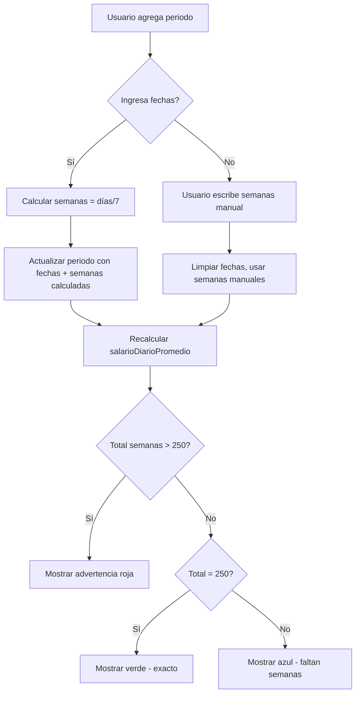

# Plan: Mejoras al Desglose Sal. Prom — Fechas, Validación y Limpieza

## Resumen

Tres mejoras solicitadas:
1. **Feature 7**: Permitir ingresar periodos por **rango de fechas** (fecha inicio + fecha fin) como viene en la hoja de cotización del IMSS, calculando las semanas automáticamente (días / 7).
2. **Feature 8**: Agregar **validación visual** cuando el total de semanas exceda 250.
3. **Feature 9**: Permitir **ocultar/eliminar periodos en desuso** (ej. periodo 7 y 8 con salario=0 y semanas=0) para no estorbar en la UI.

---

## Feature 7: Ingreso por Rango de Fechas

### Estado Actual

El modelo [`PeriodoSalarial`](lib/core/models/periodo_salarial.dart:12-28) YA tiene los campos `fechaInicio` y `fechaTermino` (DateTime?), pero en la UI de [`_buildPeriodoRow`](lib/presentation/screens/captura_view.dart:527-645) solo se muestran `Salario` y `Semanas`. Las fechas existen en el modelo pero no tienen UI.

### Cambios Necesarios

#### 1. [`PeriodoSalarial`](lib/core/models/periodo_salarial.dart) — Agregar getter `semanasCalculadas`

Agregar un getter que calcule semanas desde las fechas:
```dart
/// Semanas calculadas desde fechaInicio → fechaTermino (días / 7).
/// Retorna null si faltan fechas.
double? get semanasDesdeFechas {
  if (fechaInicio == null || fechaTermino == null) return null;
  return fechaTermino!.difference(fechaInicio!).inDays / 7.0;
}
```

#### 2. [`captura_view.dart`](lib/presentation/screens/captura_view.dart:527-645) — Rediseñar `_buildPeriodoRow`

Cada fila de periodo debe mostrar:

```
[Label]  [Fecha Inicio]  [Fecha Término]  [Salario]  [Semanas*]  [Resultado]
```

Donde:
- **Fecha Inicio** / **Fecha Término**: DatePicker o campo de texto con formato DD/MM/YYYY
- **Semanas***: Campo de solo lectura (o editable) que se auto-rellena al cambiar fechas
- Si el usuario escribe semanas manualmente, las fechas se ignoran (o viceversa)
- **Resultado**: Salario × Semanas (solo lectura)

**Comportamiento:**
- Si el usuario selecciona **fecha inicio + fecha término** → `semanas` se calcula automáticamente como `días / 7`
- Si el usuario **escribe semanas manualmente** → las fechas se limpian (se ponen null) y se usa el valor manual
- El campo `semanas` debe mostrar el valor calculado pero permitir edición manual

#### 3. [`retroactive_provider.dart`](lib/services/retroactive_provider.dart:474-486) — Actualizar `updatePeriodo`

El método `updatePeriodo` debe:
- Si se actualizan fechas: calcular `semanas = días / 7` y guardar
- Si se actualiza semanas manualmente: limpiar fechas (`fechaInicio = null, fechaTermino = null`)
- Recalcular `_salarioDiarioPromedio` desde los periodos actualizados

#### 4. Persistencia

El modelo ya tiene [`toJson()` / `fromJson()`](lib/core/models/periodo_salarial.dart:47-60) que serializa `fechaInicio` y `fechaTermino`. No hay cambios necesarios en [`persistence_service.dart`](lib/services/persistence_service.dart).

---

## Feature 8: Validación de Total de Semanas ≤ 250

### Estado Actual

En [`_buildPeriodosSummary`](lib/presentation/screens/captura_view.dart:648-680) se muestra:
```
Total: {sum} / 250 sem  ·  Prom: ${promedio}
```
No hay advertencia si el total excede 250.

### Cambios Necesarios

#### 1. [`captura_view.dart`](lib/presentation/screens/captura_view.dart:648-680) — Modificar `_buildPeriodosSummary`

Agregar lógica de validación visual:
- Si `totalSemanas > totalSemanasPromedio` (250):
  - Cambiar color de fondo a rojo claro (`Colors.red.shade50`)
  - Mostrar ícono de advertencia (`Icons.warning_amber`)
  - Mostrar texto: `"⚠ Total: {sum} / 250 sem — Excede el límite en {exceso} sem"`
  - El promedio ponderado se recalcula dividiendo entre `totalSemanas` (no 250), como ya hace [`nuevoSalarioPromedio`](lib/services/retroactive_provider.dart:175-176)
- Si `totalSemanas == totalSemanasPromedio` (250 exactas):
  - Color verde claro (`Colors.green.shade50`)
  - Mostrar: `"✓ Total: 250 / 250 sem — Exacto"`
- Si `totalSemanas < totalSemanasPromedio` (menos de 250):
  - Color azul claro (como ahora)
  - Mostrar: `"Total: {sum} / 250 sem  ·  Faltan {restante} sem"`

#### 2. Tooltip de advertencia

En el summary, agregar un tooltip que explique:
- "Las semanas totales del desglose no deben exceder 250 (totalSemanasPromedio). Si excede, el promedio se calcula dividiendo entre el total real de semanas."

---

## Diagrama de Flujo



---

## Archivos a Modificar

| Archivo | Cambio |
|---------|--------|
| [`lib/core/models/periodo_salarial.dart`](lib/core/models/periodo_salarial.dart) | Agregar getter `semanasDesdeFechas` |
| [`lib/presentation/screens/captura_view.dart`](lib/presentation/screens/captura_view.dart:527-645) | Rediseñar `_buildPeriodoRow` con campos de fecha; modificar `_buildPeriodosSummary` con validación visual |
| [`lib/services/retroactive_provider.dart`](lib/services/retroactive_provider.dart:474-486) | Actualizar `updatePeriodo` para manejar fechas |

## No Requiere Cambios

- [`persistence_service.dart`](lib/services/persistence_service.dart) — Ya serializa fechas correctamente
- [`pension_view.dart`](lib/presentation/screens/pension_view.dart) — El copy button ya muestra los datos correctos
- Tests existentes — No deberían romperse porque el modelo sigue siendo compatible

---

## Feature 9: Ocultar/Eliminar Periodos en Desuso

### Problema

El usuario puede crear periodos de más (ej. agrega 8 periodos pero solo usa 5). Los periodos 6, 7, 8 quedan con `salario=0` y `semanas=0`, ocupando espacio en la UI y causando confusión.

### Solución Propuesta

#### Opción A: Ocultar periodos con salario=0 y semanas=0 (Recomendada)

En [`_buildDesglosePeriodos`](lib/presentation/screens/captura_view.dart:473-521), filtrar los periodos con `salarioDiario == 0 && semanas == 0` para no mostrarlos:

```dart
final periodosVisibles = periodos.where((p) =>
    p.salarioDiario != 0 || p.semanas != 0).toList();
```

Pero mantenerlos en la lista interna para no perder el orden. Agregar un botón "Limpiar periodos vacíos" que los elimine definitivamente.

#### Opción B: Botón "Eliminar" en cada periodo (Ya existe parcialmente)

Actualmente solo el periodo Mod40 **no** tiene botón de eliminar. Los periodos normales (no Mod40) ya tienen un icono `remove_circle_outline`. El problema es que si el usuario crea 8 periodos, tiene que eliminar uno por uno.

**Mejora:** Agregar un botón "Limpiar no usados" que elimine de una vez todos los periodos con `salarioDiario == 0 && semanas == 0`.

#### Implementación

1. En [`captura_view.dart`](lib/presentation/screens/captura_view.dart:503-518), junto al botón "Agregar periodo", agregar un botón "Limpiar vacíos":
   ```dart
   if (periodos.any((p) => !p.esMod40 && p.salarioDiario == 0 && p.semanas == 0))
     TextButton.icon(
       onPressed: () => provider.removePeriodosVacios(),
       icon: Icon(Icons.auto_fix_high, size: 13),
       label: Text('Limpiar vacíos', ...),
     )
   ```

2. En [`retroactive_provider.dart`](lib/services/retroactive_provider.dart), agregar método:
   ```dart
   void removePeriodosVacios() {
     _periodos.removeWhere((p) => !p.esMod40 && p.salarioDiario == 0 && p.semanas == 0);
     persistence.savePeriodos(_periodos);
     _salarioDiarioPromedio = nuevoSalarioPromedio;
     persistence.saveSalarioDiarioPromedio(_salarioDiarioPromedio);
     _recalculateFactAsig();
     _recalculatePensionMod40();
     _recalculateInversion();
     notifyListeners();
   }
   ```

---

## Orden de Implementación

1. **Feature 7a**: Agregar getter `semanasDesdeFechas` en [`PeriodoSalarial`](lib/core/models/periodo_salarial.dart)
2. **Feature 7b**: Rediseñar [`_buildPeriodoRow`](lib/presentation/screens/captura_view.dart:527-645) para incluir DatePicker de inicio/fin
3. **Feature 7c**: Actualizar [`updatePeriodo`](lib/services/retroactive_provider.dart:474-486) para auto-calcular semanas desde fechas
4. **Feature 8**: Modificar [`_buildPeriodosSummary`](lib/presentation/screens/captura_view.dart:648-680) con validación visual de 250 semanas
5. **Feature 9**: Agregar método `removePeriodosVacios` en provider + botón "Limpiar vacíos" en UI
6. **Build + Tests**: Verificar que todo compile y los tests sigan pasando
