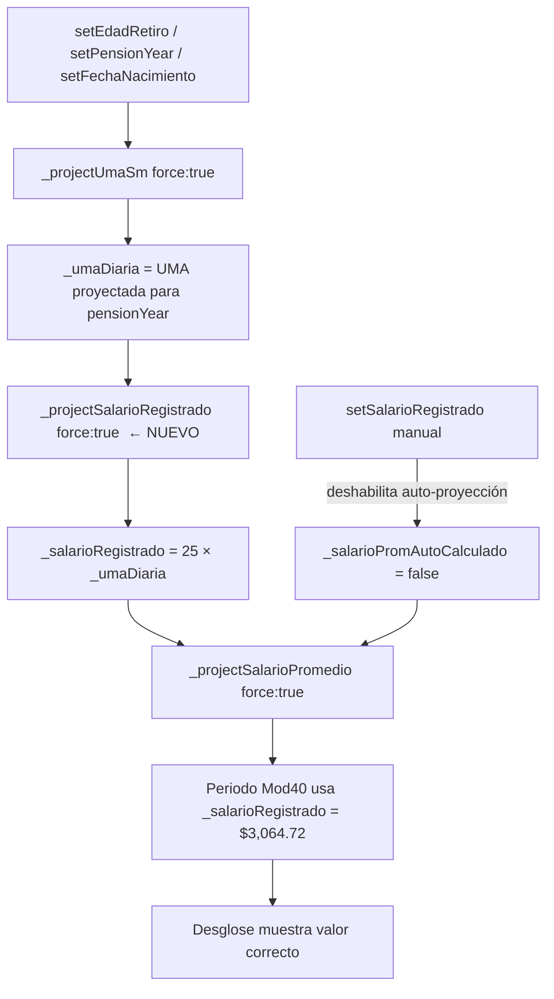

# Plan: Corrección de Bugs + Implementación de Salario Registrado desde UMAs

## Resumen

Plan detallado para:
1. **Bug 1** — Calendario no permite fechas futuras (cambio simple en captura_view.dart)
2. **Bug 2** — No permite escribir fechas manualmente (cambio simple en captura_view.dart)
3. **Bug 3** — Desglose Sal Prom Mod 40 muestra $1,500 en lugar de $3,064.72
4. **Bug 4** — 9k+ en salario promedio al cargar página

El **Bug 3** requiere un cambio de arquitectura: `salario_registrado` debe calcularse automáticamente como `25 × UMA_diaria_proyectada`, igual que en el Excel.

---

## Bug 1: El calendario no permite seleccionar fechas futuras

**Archivo:** [`lib/presentation/screens/captura_view.dart`](lib/presentation/screens/captura_view.dart:844)

**Causa:** `showDatePicker` usa `lastDate: now` (DateTime.now()), bloqueando fechas posteriores a hoy.

**Solución:** Cambiar `lastDate: now` → `lastDate: DateTime(2100)`

```dart
// Línea 844: Cambiar de:
lastDate: now,
// A:
lastDate: DateTime(2100),
```

---

## Bug 2: No permite escribir fechas manualmente en el campo de texto

**Archivo:** [`lib/presentation/screens/captura_view.dart`](lib/presentation/screens/captura_view.dart:827-836)

**Causa:** El `onChanged` solo auto-formatea cuando el usuario escribe 8 dígitos SIN guiones (`v.length == 8 && !v.contains('-')`). Si el usuario escribe `YYYY-MM-DD` (con guiones), nunca se formatea.

**Solución:** Eliminar restricciones `v.length == 8` y `!v.contains('-')`:

```dart
// Líneas 827-836: Cambiar de:
onChanged: (v) {
  final cleaned = v.replaceAll('-', '');
  if (cleaned.length == 8 && v.length == 8 && !v.contains('-')) {
    final formatted = _autoFormatDate(v);
    controller.text = formatted;
    controller.selection = TextSelection.collapsed(offset: formatted.length);
  }
  onChanged(v);
},
// A:
onChanged: (v) {
  final cleaned = v.replaceAll('-', '');
  if (cleaned.length == 8) {
    final formatted = _autoFormatDate(cleaned);
    if (formatted != v) {
      controller.text = formatted;
      controller.selection = TextSelection.collapsed(offset: formatted.length);
    }
  }
  onChanged(v);
},
```

---

## Bug 3: Desglose Sal Prom Mod 40 muestra $1,500 en lugar de $3,064.72

### Causa Raíz

En el Excel [`_sheet_SAL. PROM MOD 40`](excel_audit_reference.json:5636-5716), el salario registrado se calcula como:

> **C12 = C7 × C11 = 25 UMAs × $122.58895 = $3,064.72**

Donde:
- C7 = 25 (Salario Diario Registrado en UMA's, fijo del IMSS)
- C11 = $122.58895 (UMA diaria proyectada para 2027)

En la app, [`_salarioRegistrado`](lib/services/retroactive_provider.dart:270) se carga desde persistencia con default [`$1,500`](assets/config/app_metadata.json:526). **No existe código que calcule `salario_registrado = 25 × UMA_diaria`.**

La app YA tiene:
- [`uma_projection_table`](assets/config/app_metadata.json:108-128) con valores proyectados por año
- [`_projectUmaSm()`](lib/services/retroactive_provider.dart:773-782) que proyecta UMA diaria desde `_pensionYear`
- [`getProjectedUma()`](lib/services/retroactive_provider.dart:777) que busca la UMA del año correspondiente

Pero `_salarioRegistrado` nunca se conectó con este sistema.

### Solución: Calcular `salario_registrado = 25 × UMA_diaria_proyectada`

#### Cambio 1: Agregar método `_projectSalarioRegistrado()` en [`retroactive_provider.dart`](lib/services/retroactive_provider.dart)

Crear un nuevo método que calcule `salario_registrado` desde la UMA diaria proyectada:

```dart
/// Proyecta el salario registrado como 25 UMAs × UMA diaria proyectada.
/// Se llama después de _projectUmaSm() para asegurar que _umaDiaria esté actualizada.
void _projectSalarioRegistrado({bool force = false}) {
  if (!force && !_salarioPromAutoCalculado) return;
  
  // Calcular: 25 UMAs × UMA diaria proyectada
  final nuevoSalario = 25.0 * _umaDiaria;
  
  if (nuevoSalario != _salarioRegistrado) {
    _salarioRegistrado = nuevoSalario;
    persistence.saveSalarioRegistrado(_salarioRegistrado);
  }
}
```

#### Cambio 2: Llamar `_projectSalarioRegistrado()` después de `_projectUmaSm()` en todos los lugares donde se proyecta UMA

**En [`initialize()`](lib/services/retroactive_provider.dart:313-321):**
```dart
// Después de _projectUmaSm(force: true) en línea 313:
_projectUmaSm(force: true);
_projectSalarioRegistrado(force: true);  // ← NUEVO

// Antes de _projectSalarioPromedio(force: true) en línea 321:
_projectSalarioPromedio(force: true);
```

**En [`setPensionYear()`](lib/services/retroactive_provider.dart:384-385):**
```dart
_projectUmaSm(force: true);
_projectSalarioRegistrado(force: true);  // ← NUEVO
```

**En [`setEdadRetiro()`](lib/services/retroactive_provider.dart:516):**
```dart
_projectUmaSm(force: true);
_projectSalarioRegistrado(force: true);  // ← NUEVO
```

**En [`setFechaNacimiento()`](lib/services/retroactive_provider.dart:602):**
```dart
_projectUmaSm(force: true);
_projectSalarioRegistrado(force: true);  // ← NUEVO
```

#### Cambio 3: Actualizar `setSalarioRegistrado()` para mantener coherencia

En [`setSalarioRegistrado()`](lib/services/retroactive_provider.dart:525-536), cuando el usuario edita manualmente, debe deshabilitar la auto-proyección (como ya hacen `setUmaDiaria` y `setSalarioMinimoDiario`):

```dart
void setSalarioRegistrado(double v) {
  if (v == _salarioRegistrado) return;
  _salarioRegistrado = v;
  // User manually edited → disable auto-projection
  _salarioPromAutoCalculado = false;  // ← NUEVO (o una bandera específica)
  persistence.saveSalarioRegistrado(v);
  _projectSalarioPromedio(force: true);
  _recalculateCostoMod40();
  _recalculateFactAsig();
  _recalculatePensionMod40();
  _recalculateInversion();
  notifyListeners();
}
```

#### Cambio 4: Actualizar metadata defaults

En [`app_metadata.json:526`](assets/config/app_metadata.json:526), cambiar el default de `salario_registrado` para que coincida con el cálculo esperado:

```json
"salario_registrado": 3064.72,
```

O mejor aún, dejarlo como `0.0` para que el cálculo automático lo sobrescriba siempre.

#### Diagrama del flujo corregido



---

## Bug 4: Al cargar la página muestra 9k+ en salario promedio

**Causa:** Valor corrupto en SharedPreferences de una versión anterior donde el default era ~$9,879.59.

**Solución:** Ya existe `_projectSalarioPromedio(force: true)` en [`initialize()`](lib/services/retroactive_provider.dart:321) que recalcula desde los valores actuales. Con la corrección del Bug 3, `_salarioRegistrado` ahora se calculará correctamente desde UMAs, y `_salarioDiarioPromedio` se recalculará desde `_salarioRegistrado` y `_salarioPromedio250Semanas`.

**No se requiere cambio de código adicional** — la proyección forzada ya existe.

---

## Resumen de Cambios

| # | Archivo | Cambio | Riesgo |
|---|---------|--------|--------|
| 1 | [`captura_view.dart:844`](lib/presentation/screens/captura_view.dart:844) | `lastDate: now` → `lastDate: DateTime(2100)` | Bajo |
| 2 | [`captura_view.dart:827-836`](lib/presentation/screens/captura_view.dart:827) | Permitir auto-formateo con entrada YYYY-MM-DD | Bajo |
| 3 | [`retroactive_provider.dart`](lib/services/retroactive_provider.dart) | Nuevo método `_projectSalarioRegistrado()` + llamadas en 4 lugares | Medio |
| 4 | [`app_metadata.json:526`](assets/config/app_metadata.json:526) | Actualizar default `salario_registrado` | Bajo |

## Pruebas

1. Abrir Captura → tocar campo de fecha → calendario debe permitir seleccionar 2026, 2027, etc.
2. Escribir `20260724` → debe auto-formatear a `2026-07-24`
3. Escribir `2026-07-24` → también debe auto-formatear correctamente
4. Verificar Desglose Sal. Prom → período Mod40 muestra `25 × UMA_diaria` (~$3,064.72)
5. Cambiar edad de retiro → `salario_registrado` debe recalcularse automáticamente
6. Editar `salario_registrado` manualmente → debe respetar el valor manual (no sobrescribir)
7. Recargar página → verificar que no aparezca 9k+
