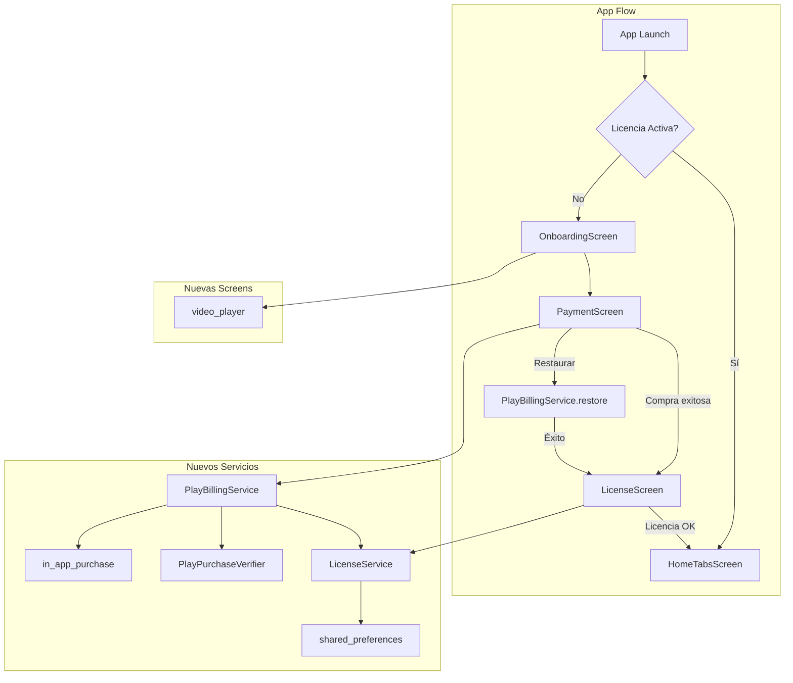

# Plan de Implementación: Portar Módulos de `machote` a `D-0-Pension`

## Objetivo

Portar los siguientes 5 módulos del proyecto `machote` (Cuentacuentos Mágico ASMR) a `D-0-Pension` (Calculadora Ley 73 IMSS):

1. **Video Onboarding** - Pantalla de introducción con video
2. **Google Play Billing** - Servicio de compras/restauración in-app
3. **Licencia/Suscripción** - Control de acceso basado en licencia
4. **Pantalla de Pago** - Selección de plan + checkout
5. **Login** (opcional) - Autenticación de usuario

**NO** se modifica ningún archivo del proyecto `machote`. Solo se lee el código fuente como referencia.

---

## Arquitectura Propuesta



---

## Dependencias a Agregar

En [`pubspec.yaml`](pubspec.yaml), agregar bajo `dependencies:`:

```yaml
  in_app_purchase: ^3.1.11
  video_player: ^2.10.0
  google_fonts: ^6.2.1
  crypto: ^3.0.6
  package_info_plus: ^8.3.0
```

Luego ejecutar: `flutter pub get`

---

## Paso a Paso de Implementación

### PASO 1: Crear estructura de directorios

Crear las siguientes carpetas:

```
lib/
  services/
    billing/              # Servicios de facturación
      play_billing_service.dart
      play_purchase_success.dart
      play_purchase_verifier.dart
  presentation/
    screens/
      onboarding_screen.dart
      payment_screen.dart
      license_screen.dart
  core/
    models/
      license_model.dart   # Modelo de licencia
```

---

### PASO 2: Portar `PlayPurchaseSuccess` y `PlayPurchaseVerifier`

**Archivos a crear:**

1. [`lib/services/billing/play_purchase_success.dart`](lib/services/billing/play_purchase_success.dart)
   - Portar desde `C:/Src/Proyectos/machote/lib/services/play_purchase_success.dart`
   - Clase `PlayPurchaseSuccess` con: `productId`, `purchaseToken`, `purchaseTime`, `expiryDate`
   - **Adaptación:** Reemplazar `dartz` por un `Result` propio

2. [`lib/services/billing/play_purchase_verifier.dart`](lib/services/billing/play_purchase_verifier.dart)
   - Portar desde `C:/Src/Proyectos/machote/lib/services/play_purchase_verifier.dart`
   - Funciones: `verifyPlayStorePurchase()`, `verifyPlayStoreRestore()`
   - Usa `crypto` package para verificación de firmas HMAC-SHA1

3. [`lib/core/models/result.dart`](lib/core/models/result.dart) (NUEVO)
   - Clase genérica `Result<T>` para reemplazar `Either<Failure, Success>` de `dartz`
   - Evita agregar dependencia de `dartz`

```dart
// Ejemplo de Result<T>
sealed class Result<T> {
  const Result();
}
class Success<T> extends Result<T> {
  final T value;
  const Success(this.value);
}
class Failure<T> extends Result<T> {
  final String message;
  const Failure(this.message);
}
```

---

### PASO 3: Portar `PlayBillingService`

**Archivo a crear:** [`lib/services/billing/play_billing_service.dart`](lib/services/billing/play_billing_service.dart)

Portar desde `C:/Src/Proyectos/machote/lib/services/play_billing_service.dart` (~440 líneas)

**Adaptaciones necesarias:**
- Reemplazar `Either<Failure, PlayPurchaseSuccess>` por `Result<PlayPurchaseSuccess>`
- Reemplazar `Failure` por `String message` en Failure
- Mantener: `_BillingSession`, timeouts (10s silencio, 90s pendiente, 30s compra, 15s restauración)
- Mantener: `_looksLikeAlreadyOwnedSubscription()`, `_mapStoreError()`
- Mantener: `purchaseAnnualLicense()`, `restoreAnnualLicense()`, `billingAvailable()`

**NO cambiar:** La lógica de negocio de Play Billing (timeouts, verificación, manejo de errores)

---

### PASO 4: Portar `LicenseService`

**Archivo a crear:** [`lib/services/billing/license_service.dart`](lib/services/billing/license_service.dart)

Portar desde `C:/Src/Proyectos/machote/lib/services/license_service.dart` (~13 líneas)

```dart
class LicenseService {
  LicenseService._();

  static bool isLicenseExpired(DateTime? licenseExpiry) {
    if (licenseExpiry == null) return false; // perpetua
    return DateTime.now().isAfter(licenseExpiry);
  }
}
```

**Adaptación:** En lugar de `UserProfile`, usar directamente `DateTime? licenseExpiry`

---

### PASO 5: Portar `OnboardingScreen`

**Archivo a crear:** [`lib/presentation/screens/onboarding_screen.dart`](lib/presentation/screens/onboarding_screen.dart)

Portar desde `C:/Src/Proyectos/machote/lib/presentation/pages/onboarding_screen.dart` (~389 líneas)

**Adaptaciones:**
- Usar tema de D-0-Pension (`AppTheme.primary`, `AppTheme.accent`) en lugar de `FamilyTheme`
- Reemplazar `GoogleFonts.nunito()` por la fuente del tema actual
- El video asset debe estar en `assets/videos/onboarding_intro.mp4`
- Navegar a `PaymentScreen` al terminar el video
- CTA con fade-in después de 3 segundos
- Fallback si el video falla

**Assets necesarios:**
- `assets/videos/onboarding_intro.mp4` (crear o comprar video promocional)
- Agregar en `pubspec.yaml`:
  ```yaml
  assets:
    - assets/videos/
  ```

---

### PASO 6: Portar `LicenseScreen`

**Archivo a crear:** [`lib/presentation/screens/license_screen.dart`](lib/presentation/screens/license_screen.dart)

Portar desde `C:/Src/Proyectos/machote/lib/presentation/pages/license_screen.dart` (~243 líneas)

**Adaptaciones:**
- Usar tema de D-0-Pension
- Mostrar: estado de licencia (vigente/expirada), días restantes, botón renovar
- Botón "Renovar" abre `PaymentScreen`
- Si licencia perpetua, mostrar "Licencia vitalicia"

---

### PASO 7: Portar `PaymentScreen`

**Archivo a crear:** [`lib/presentation/screens/payment_screen.dart`](lib/presentation/screens/payment_screen.dart)

Portar desde `C:/Src/Proyectos/machote/lib/presentation/pages/payment_screen.dart` (~560 líneas)

**Adaptaciones:**
- Usar tema de D-0-Pension
- Reemplazar BLoC por Provider/ChangeNotifier
- Integrar `PlayBillingService` para compra/restauración
- Mostrar planes de suscripción (ej: mensual, anual, vitalicio)
- Botón "Comprar" y "Restaurar"
- Manejar estados: loading, success, error
- Al comprar exitosamente: guardar licencia en `shared_preferences` y navegar a `HomeTabsScreen`

**Provider necesario:** [`lib/services/billing/payment_provider.dart`](lib/services/billing/payment_provider.dart)
- State: `PaymentState { idle, loading, success, error }`
- Métodos: `purchase(productId)`, `restore(productId)`, `checkLicense()`

---

### PASO 8: Portar `LoginScreen` (OPCIONAL - Baja Prioridad)

**Archivo a crear:** [`lib/presentation/screens/login_screen.dart`](lib/presentation/screens/login_screen.dart)

Portar desde `C:/Src/Proyectos/machote/lib/presentation/pages/login_screen.dart` (~653 líneas)

**Adaptaciones:**
- Reemplazar BLoC (`UserBloc`) por `LoginProvider extends ChangeNotifier`
- Usar tema de D-0-Pension
- Mantener: animación de logo, gradiente, formulario con validación, "recordarme"
- Mantener: persistencia de sesión en `shared_preferences`

**Provider necesario:** [`lib/services/billing/login_provider.dart`](lib/services/billing/login_provider.dart)

---

### PASO 9: Modificar `main.dart` para integrar onboarding + licencia

En [`lib/main.dart`](lib/main.dart):

```dart
void main() async {
  WidgetsFlutterBinding.ensureInitialized();
  
  final prefs = await SharedPreferences.getInstance();
  final persistenceService = PersistenceService(prefs);
  final formulaEvaluator = FormulaEvaluator();
  final billingService = PlayBillingService();

  runApp(
    MultiProvider(
      providers: [
        ChangeNotifierProvider(create: (_) => RetroactiveProvider(...)),
        ChangeNotifierProvider(create: (_) => PaymentProvider(billingService, prefs)),
      ],
      child: const PensionCalculatorApp(),
    ),
  );
}
```

**Lógica de entrada:**
- Si NO hay licencia activa → mostrar `OnboardingScreen`
- Si hay licencia activa → mostrar `HomeTabsScreen` (como ahora)

---

### PASO 10: Configurar Android para Play Store

**Archivos a modificar/crear:**

1. [`android/app/build.gradle.kts`](android/app/build.gradle.kts):
   - Configurar `applicationId` (ej: `com.tupension.ley73`)
   - Configurar `versionCode` y `versionName`
   - Agregar dependencia de Play Billing (ya viene con `in_app_purchase`)

2. **Crear keystore** para firmar APK:
   ```bash
   keytool -genkey -v -keystore d-0-pension-keystore.jks -keyalg RSA -keysize 2048 -validity 10000 -alias d0pension
   ```

3. **Crear** [`android/key.properties`](android/key.properties):
   ```properties
   storePassword=<tu-password>
   keyPassword=<tu-password>
   keyAlias=d0pension
   storeFile=d-0-pension-keystore.jks
   ```

4. **Crear proyecto Firebase** (opcional, para Analytics):
   - Descargar `google-services.json` y colocarlo en `android/app/`
   - Agregar plugin de Google Services en `android/build.gradle.kts`

5. **Configurar producto en Play Console:**
   - ID de producto sugerido: `subscription_annual_ley73`
   - Tipo: Suscripción (renovable anual) o Consumible (pago único)

---

### PASO 11: Pruebas

**Tests a crear:**

1. [`test/billing/play_billing_service_test.dart`](test/billing/play_billing_service_test.dart)
   - Testear `billingAvailable()` (mock)
   - Testear `purchaseAnnualLicense()` (mock)
   - Testear `restoreAnnualLicense()` (mock)
   - Testear `_looksLikeAlreadyOwnedSubscription()`

2. [`test/billing/license_service_test.dart`](test/billing/license_service_test.dart)
   - Testear `isLicenseExpiry()` con fecha futura → false
   - Testear `isLicenseExpiry()` con fecha pasada → true
   - Testear `isLicenseExpiry()` con null → false (perpetua)

3. [`test/screens/onboarding_screen_test.dart`](test/screens/onboarding_screen_test.dart)
   - Testear que el video se muestra
   - Testear que el CTA aparece después del delay
   - Testear fallback si el video falla

4. [`test/screens/payment_screen_test.dart`](test/screens/payment_screen_test.dart)
   - Testear que los planes se muestran
   - Testear flujo de compra exitosa
   - Testear flujo de restauración exitosa

---

## Resumen de Archivos a Crear/Modificar

### Archivos NUEVOS (13)

| # | Archivo | Fuente | Líneas |
|---|--------|--------|--------|
| 1 | `lib/core/models/result.dart` | Nuevo | ~30 |
| 2 | `lib/services/billing/play_purchase_success.dart` | machote | ~40 |
| 3 | `lib/services/billing/play_purchase_verifier.dart` | machote | ~80 |
| 4 | `lib/services/billing/play_billing_service.dart` | machote | ~440 |
| 5 | `lib/services/billing/license_service.dart` | machote | ~15 |
| 6 | `lib/services/billing/payment_provider.dart` | Nuevo | ~100 |
| 7 | `lib/presentation/screens/onboarding_screen.dart` | machote | ~390 |
| 8 | `lib/presentation/screens/payment_screen.dart` | machote | ~560 |
| 9 | `lib/presentation/screens/license_screen.dart` | machote | ~250 |
| 10 | `lib/presentation/screens/login_screen.dart` | machote (opcional) | ~650 |
| 11 | `lib/services/billing/login_provider.dart` | Nuevo (opcional) | ~80 |
| 12 | `test/billing/play_billing_service_test.dart` | Nuevo | ~100 |
| 13 | `test/billing/license_service_test.dart` | Nuevo | ~30 |

### Archivos MODIFICADOS (3)

| # | Archivo | Cambio |
|---|--------|--------|
| 1 | `pubspec.yaml` | Agregar 5 dependencias + assets/videos/ |
| 2 | `lib/main.dart` | Agregar PaymentProvider, lógica de onboarding/licencia |
| 3 | `android/app/build.gradle.kts` | Configurar versionCode, signing, Play Billing |

### Assets NUEVOS (1)

| # | Asset | Descripción |
|---|-------|-------------|
| 1 | `assets/videos/onboarding_intro.mp4` | Video promocional de la calculadora |

---

## Prompt de Ejecución para Code Mode

```
Implementa el plan detallado en plans/porting_machote_modules.md.

ORDEN DE EJECUCIÓN:
1. Agregar dependencias en pubspec.yaml y ejecutar flutter pub get
2. Crear lib/core/models/result.dart (Result<T> genérico)
3. Portar play_purchase_success.dart y play_purchase_verifier.dart
4. Portar play_billing_service.dart (reemplazar Either por Result)
5. Portar license_service.dart
6. Crear payment_provider.dart
7. Portar onboarding_screen.dart (usar tema D-0-Pension)
8. Portar payment_screen.dart (usar Provider en lugar de BLoC)
9. Portar license_screen.dart
10. Modificar main.dart para integrar onboarding + licencia
11. Modificar android/app/build.gradle.kts para Play Store
12. Crear tests unitarios

REGLAS:
- NO modificar ningún archivo del proyecto machote
- Usar tema de D-0-Pension (AppTheme.primary, AppTheme.accent) en todas las nuevas screens
- Reemplazar BLoC por Provider/ChangeNotifier
- Reemplazar dartz (Either) por Result<T> propio
- Mantener TODA la lógica de negocio de Play Billing intacta
- Ejecutar flutter analyze después de cada paso
- Ejecutar flutter test después de cada paso
```

---

## Notas Adicionales

1. **Video asset:** Si no hay video disponible, se puede crear un placeholder simple o usar una imagen con animación como fallback.

2. **Firebase:** Es opcional. Machote lo usa solo para Analytics. Se puede omitir en la primera versión.

3. **Login:** Es el módulo de menor prioridad. La calculadora funciona sin autenticación. Recomiendo implementarlo solo si se necesita multi-usuario o sincronización en la nube.

4. **IDs de producto en Play Console:** Definir antes de implementar:
   - `subscription_annual_ley73` - Suscripción anual
   - `license_perpetual_ley73` - Licencia vitalicia (pago único)

5. **Precios sugeridos:**
   - Suscripción anual: ~$199 MXN
   - Licencia vitalicia: ~$499 MXN
